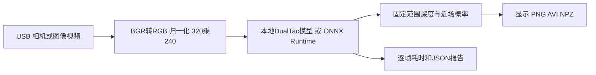

# T7 轻量近场深度感知与 Jetson 部署

将游戏 T7 的视觉灵感落到一个 RGB 摄像头驱动的可穿戴深度感知原型：摄像头采集、轻量网络推理、固定尺度显示，以及可复核的性能报告。

当前主线接入已有 **DualTacV2 V6 深度网络，937,227 参数，训练输入 320×240**。模型输出固定范围逆深度与近场 logits，解码范围 **0.20–1.00 m**，训练近场边界 **0.40 m**。显示颜色代表模型估计的深度，不表示温度；更换相机或应用场景后需要真实近场标定与验证。

[历史成品展示](https://v.douyin.com/elDdhLb8Omg/) · [Jetson 部署](docs/JETSON.md) · [测量口径](docs/BENCHMARK.md) · [本机验收](docs/VALIDATION.md) · [简历表述](docs/PORTFOLIO.md)

> 历史视频展示原始 Depth Anything 版本的物理原型，不代表本次轻量模型已在 B01 上重新验收。原始项目说明保存在 [ORIGINAL_README.md](docs/ORIGINAL_README.md)。

## 运行链路



| 能力 | 当前实现 |
|---|---|
| 轻量模型接入 | 从本地源码和干净 checkpoint 严格加载，核查架构、参数、归一化与输出契约 |
| PyTorch | CPU FP32、CUDA FP32/FP16；显式设备选择和 CUDA 同步计时 |
| ONNX | 固定形状 FP32 导出、opset 13、可选 ORT 数值一致性检查、文件及契约校验 |
| 输入输出 | 摄像头、单图、视频；原图与深度并排、深度图、近场概率叠加、PNG、AVI、末帧数值 NPZ |
| 性能报告 | warmup 分离、每帧样本、mean/p50/p95、pipeline FPS、软件环境与模型 SHA256 |
| 测试 | 无私有权重也能运行的数值／视频／输出测试，以及可选真实 checkpoint 测试 |

## 模型资产边界

DualTacV2 的模型实现与训练权重由本地工程提供，**本次改造不分发这些私有资产**。运行 PyTorch 路线需要合法取得包含下列文件的工程：

```text
DualTacV2/
  src/depth_encoder_decoder.py
  checkpoints/depth_pretrained.pt
```

没有这些资产也可以运行部署管线单元测试。部署到板端时，可以在开发机导出 ONNX 与契约 JSON，再按自己的资产权限传到设备。`models/`、`artifacts/`、`runs/` 和新权重文件均被 Git 忽略。

历史 `depth_anything_v2/` 与已跟踪的 ViT-S checkpoint 保留用于溯源，不是当前主线运行依赖。相关来源见 [THIRD_PARTY_NOTICES.md](THIRD_PARTY_NOTICES.md)。

## 快速开始

先准备匹配设备的 PyTorch。桌面可按自己的 CPU/CUDA 环境安装；Jetson 必须匹配 JetPack，详见 [板端说明](docs/JETSON.md)。其余运行依赖：

```bash
python -m pip install -r requirements.txt
python work.py --help
```

没有桌面显示时，可用 `opencv-python-headless` 代替 `opencv-python`，不要在同一环境混装二者。

Windows 开发机连接当前本地工程：

```powershell
python work.py --dualtac-root "D:\Desktop\DualTacV2" --source 0 --device cuda --report runs/camera.json
```

Linux/Jetson 已有可用 PyTorch 环境：

```bash
python3 work.py --dualtac-root /path/to/DualTacV2 --source 0 --device cuda --report runs/camera.json
```

按 `q` 或 `Esc` 退出。默认使用全部视频／摄像头帧；单张图像默认推理一次。`--frames 300` 可限定测量帧数；`--width` 和 `--height` 是相机请求尺寸，网络输入来自 checkpoint，不随采集尺寸自动变大。

### 图像 视频与无窗口运行

```bash
python work.py --dualtac-root /path/to/DualTacV2 --source example.jpg --headless --output runs/depth.png --save-depth runs/depth.npz --report runs/image.json
python work.py --dualtac-root /path/to/DualTacV2 --source example.avi --headless --frames 300 --output runs/preview.avi --report runs/video.json
```

`--view near` 显示 near head 概率≥0.5 的区域；它是训练任务输出，不是标定后的可信度或自动安全告警。NPZ 中深度单位是米，尺寸为网络输出 240×320，而可视化会缩放到捕获尺寸。

### 导出 ONNX 并验证

```bash
python -m pip install -r requirements-onnx.txt
python -m t7_vision.export --dualtac-root /path/to/DualTacV2 --output artifacts/dualtac_v6_fp32.onnx --verify
python work.py --backend onnx --onnx-model artifacts/dualtac_v6_fp32.onnx --source example.avi --headless --report runs/ort.json
```

`.onnx` 必须与 `.onnx.json` 成对复制。导出验证检查两个合成张量上的数值一致性；没有深度真值，不构成精度评测。CUDA provider 仅在已安装的 ORT 提供它时可选择；TensorRT engine 构建与板端性能验收仍需在目标环境完成。

## 测试与复现

不需要 PyTorch 或模型资产的管线测试：

```bash
python -m unittest discover -s tests -v
```

已取得模型资产时，可启用真实 checkpoint 测试：

```powershell
$env:T7_DUALTAC_ROOT="D:\Desktop\DualTacV2"
python -m unittest discover -s tests -v
```

CI 只运行公开、无权重测试。更多运行命令及计时边界见 [BENCHMARK.md](docs/BENCHMARK.md)。

## 结果与待办

[VALIDATION.md](docs/VALIDATION.md) 记录本次桌面 CPU/CUDA/ORT 运行结果，并链接原始 JSON。这里只记录已测量结果，B01 的实时相机 FPS、功耗、持续运行稳定性及真实场景深度误差仍需附对应板端报告。

当前完成的是已有网络到可复核部署流程的接入；后续重点是 B01 同源视频基准、目标 TensorRT 引擎与真实近场适配。
